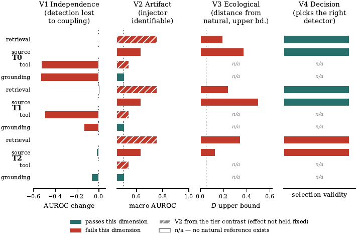

# Can an Injected-Failure Benchmark Pick Your Monitor?

Code, results and paper for **"Can an Injected-Failure Benchmark Pick Your Monitor? A
Four-Part Validity Audit for Enterprise Agent Deployment"**, NeurIPS 2026 Workshop on
Agentic AI Benchmarks and Applications for Enterprise Tasks (AABA4ET).

📄 [Workshop paper (PDF)](paper/paper.pdf)

Benchmarks for agent-failure monitors often label failures by *injecting* them into
successful trajectories. A correct label does not show that the injected failure stands in
for the failures a monitor meets in service. We treat the injector as part of the
evaluation and audit it with four tests:

| Test | Question |
|---|---|
| **V1 Independence** | Can a detector read data written only by the injector? |
| **V2 Mechanism signal** | When two methods create the same error, can a detector tell which method was used? |
| **V3 Ecological validity** | On the same task, can a detector tell injected and natural failures apart? |
| **V4 Decision validity** | Do injected and natural data lead us to pick the same monitor? |

On 24,000 HotpotQA/GSM8K agent traces, a 7,000-trace 2WikiMultiHopQA replication and the
external AEGIS benchmark, the four tests give different answers. See the paper for results.



## Repository layout

```
mirage/          Python package: agent pipeline, fault injectors (T0-T3), metrics, probes, validity tests
scripts/         Experiment runners, analyses, figure generation, number verification
configs/         YAML config for every experiment, plus the experiment registry
tests/           Integrity checks and negative controls
results/         Every result JSON the paper reports (see results/README.md)
figures/         Figures 1-4, regenerated from results/
paper/           Workshop paper: LaTeX source, figures and PDF (see paper/README.md)
docs/            Pre-registered research plan and experiment registry
data/            How to download the raw traces and checksums
CLAIMS.md        Confirmatory claim registry, frozen before the final runs
```

## Quick start (CPU, no GPU or traces needed)

```bash
python3.11 -m venv .venv && source .venv/bin/activate
pip install -e '.[dev]'
make reproduce        # tests + rebuild figures + check paper numbers against results/
```

`make verify` fails if any headline number in the paper differs from `results/*.json`.
Trace-level negative controls in `tests/` skip until the traces are downloaded.
`requirements-lock.txt` pins the exact versions we used (Python 3.11).

## Full reproduction (GPU)

The pipeline uses `BAAI/bge-base-en-v1.5`, `BAAI/bge-reranker-base` and
`Qwen/Qwen2.5-7B-Instruct` (generator and judge). Models and datasets download from Hugging
Face on first use (about 25 GB). The main campaign took 15.2 GPU-hours on an RTX A6000.

```bash
export HF_HOME=$PWD/.hf_cache
python scripts/preflight.py --config configs/experiments/P0_pilot.yaml

# Main HotpotQA/GSM8K campaign: generate traces on every GPU, then run the analyses
python scripts/run_plan.py --dry-run     # print the schedule
python scripts/run_plan.py

# Single experiment
python scripts/run_server_experiment.py --config configs/experiments/E4_fingerprint.yaml --seed 11 --resume

# Replications
bash scripts/run_2wiki_replication.sh pilot && bash scripts/run_2wiki_replication.sh full
bash scripts/run_k3_t2.sh

# External AEGIS audit
make fetch-aegis
python scripts/run_external_aegis_audit.py
```

Traces are content-addressed, so every run resumes where it stopped. Instead of
regenerating, you can download the traces we used with `make fetch-traces` (see
[data/README.md](data/README.md)).

Configs for E5-E9 in `configs/experiments/` belong to the original pre-registered plan
(`docs/PLAN.md`). Only the analyses reported in the paper have results in `results/`.

## Pre-registration

`docs/PLAN.md` and `docs/EXPERIMENT_PLAN.md` fix each question, statistic and outcome
interpretation before the runs. `CLAIMS.md` freezes the confirmatory claims. Folds are
query-disjoint and every bootstrap resamples whole queries.

## Citation

See [CITATION.cff](CITATION.cff).

## License

MIT. The AEGIS benchmark is a separate MIT-licensed project and is not redistributed here.
